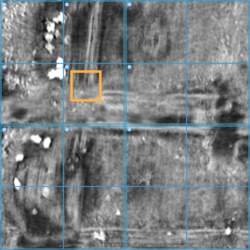
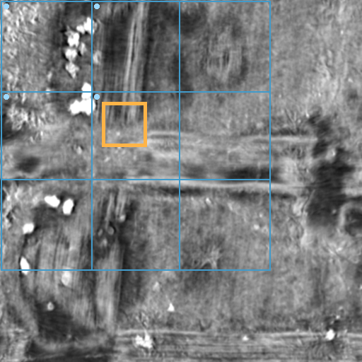
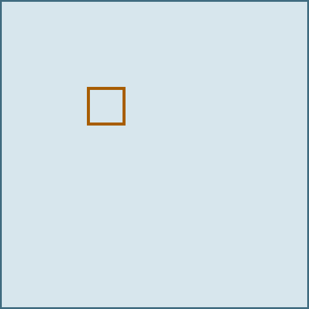
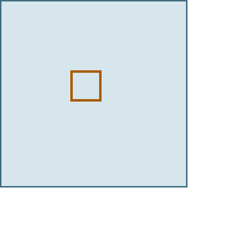
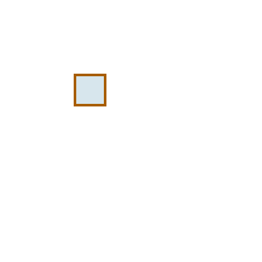

# Context-preserving regional inference for Hecate

Oisin McGlone · 26 October 2026

A Python interface for requesting a rectangular output from Hecate while preserving the parent field's tile grid, original batch groups and overlap weights. It evaluates the contributing groups and allocates blending arrays only for the requested output.

Across 11 requests and three repetitions, all 106,668 regional output values matched their full-field references. For small requests, the temporary blending arrays were **16–36× smaller than those used by carefully aligned context cropping**. Both methods used the same model windows and had similar runtimes.

The contribution is regional execution with automatic context handling and smaller output accumulators. Ink-detection accuracy was not evaluated or improved in this study.

## Report and implementation

- [Regional inference implementation](evidence/src/hecate_roi.py)
- [Recorded measurements](evidence/repeatability/result.json)
- [Reproduction instructions](evidence/README.md)
- [Complete downloadable package](https://github.com/oshcodes25/hecate-regional-inference/releases)

Download or clone the repository and open **index.html** for the illustrated report. It works offline. The `evidence/` directory contains the tested code, bounded CT inputs, saved predictions and experiment records.

## Measured result

PHerc0009B at 2.4 µm sampling: a 64 × 64-pixel output within a 512 × 512-pixel parent field. CPU float32, four threads, batch size one, fixed weights; three measured runs per method with model loading and warmup excluded.

| Method | Model windows | Seconds, median (min–max) | Temporary blending arrays | Changed output values |
| :--- | ---: | ---: | ---: | ---: |
| Full supplied field | 9 | 65.699 (61.850–121.213) | 2,048 KiB | 0 |
| Aligned context crop | 4 | 26.433 (26.381–32.165) | 1,152 KiB | 0 |
| Regional interface | 4 | 25.957 (25.456–27.086) | 32 KiB | 0 |

“Changed” means disagreement with the saved uint8 output from the parent-field run. Temporary blending storage comprises memory-mapped numerator and weight arrays; it is separate from the model's RAM requirement.

| Full supplied field | Aligned context crop | Regional interface |
| :---: | :---: | :---: |
|  |  |  |
|  |  |  |
| 512 × 512 accumulation | 384 × 384 accumulation | 64 × 64 accumulation |

Upper row: actual CT with model windows in blue and the requested output in orange. Lower row: blending-array extents at the same coordinate scale. The regional method retains the crop's input context while reducing accumulation to the output rectangle.

## Verify the saved results

Python 3.10+ and the standard library are sufficient. From the repository root:

```sh
python3 -I -S evidence/verify_repeats.py --package evidence
```

This checks file hashes, saved output equality and the arithmetic of the recorded measurements. It does not rerun inference or independently measure runtime.

## Run a regional prediction

Follow [the environment and checkpoint instructions](evidence/README.md) before running inference. From `evidence/`:

```sh
python src/hecate_roi.py \
  --runtime data/paired-resolution-audit/hecate-runtime-pinned.py \
  --checkpoint models/hecate_2.4um.pth \
  --input inputs/PHerc0009B.npy --spacing-um 2.4 \
  --roi 144 144 208 208 --output my-region.png
```

Coordinates are half-open `X0 Y0 X1 Y1` bounds in the supplied parent array. Retain the original input context and match the full run's checkpoint, stride, batch size, precision and device. Model weights are downloaded separately from the recorded source.

The [five-worker protocol](evidence/repeatability/README.md) reproduces the repeated comparison. Original experiment records and earlier reports are retained in `evidence/`; the completed repeated results are in `evidence/repeatability/result.json`.

## Scope and prior work

The repeated comparison covers three previously examined physical fields, 11 requests and three repetitions on one Mac M2 Pro. Counts include repeated measurements of the same regions. It tests software equivalence, not physical ink truth. GPU performance, independent hardware replication, full-scroll throughput and annotation-time benefit remain unverified. Large requests required all nine windows and were slightly slower than full-field execution.

The global-grid principle is established prior work: [TAUIL Abd Elilah's villa PR #1247](https://github.com/ScrollPrize/villa/pull/1247). [ArcheyChen's Hecate runner](https://github.com/ArcheyChen/vesuvius-eligible-scouting) provides an existing throughput optimisation. The released [Hecate runtime](https://huggingface.co/scrollprize/hecate/tree/9cb86e500e944b11a06a7020403cde5dffb5bcb2) supplies the model, normalisation and blending convention used here.

## Licences

Code: [MIT](LICENSE), with upstream attribution retained. CT data and derived images retain their source terms; see [DATA-NOTICE.md](evidence/DATA-NOTICE.md). Dataset: Angelotti et al., *Vesuvius Challenge — CT Scans of Herculaneum Papyri*.
